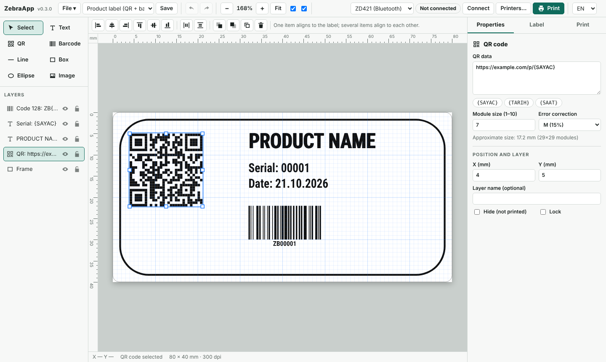
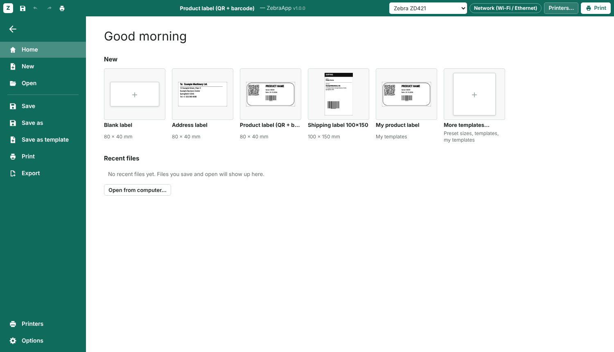
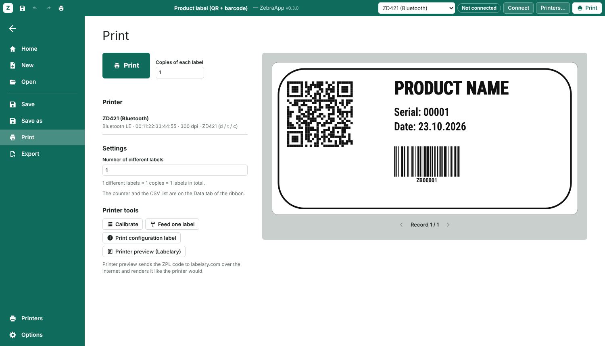
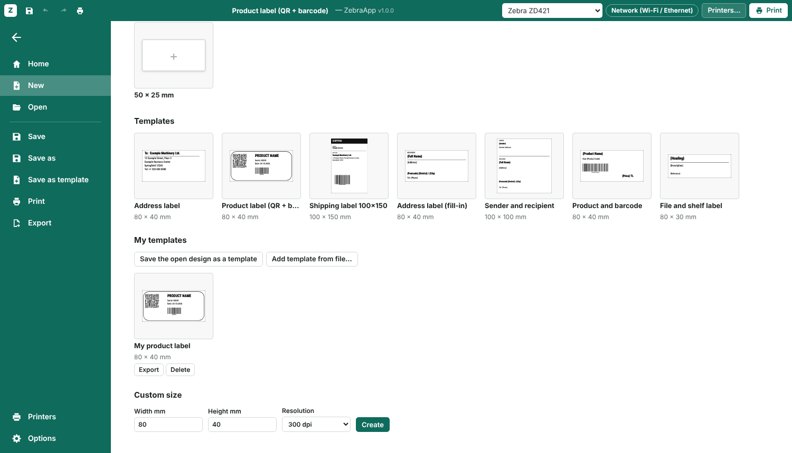
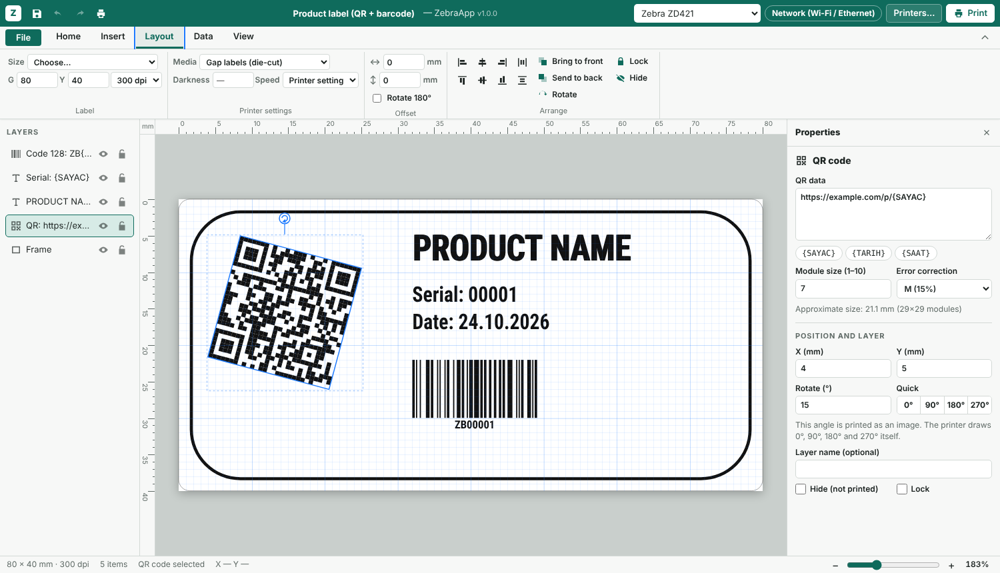

# ZebraApp

**A label designer for Zebra and other ZPL printers.** Design labels in an editor that works like a word processor (ribbon, File screen, type straight onto the label), then print over Bluetooth LE, the network, USB or a serial port. It runs on Windows, macOS and Linux: download the app and double-click it.

[Türkçe](README.tr.md)



| Start screen | Print with preview |
|---|---|
|  |  |

| Templates with fill-in fields | Rotate to any angle |
|---|---|
|  |  |

ZebraDesigner only runs on Windows, and most open-source label tools do not speak ZPL or Bluetooth LE. ZebraApp is a small local web app: a Python server talks to the printer, and the editor opens in its own window.

## Features

**Design**
- Word-style interface: ribbon tabs (Home, Insert, Layout, Data, View), a File screen with templates and recent files, quick access toolbar and a zoom slider
- Type directly on the label and format it like a word processor: select words and make them bold, italic, underlined, struck through, bigger or another font; sizes in points, character spacing, UPPER/lower/Title case, justify, top/middle/bottom in the box
- Format Painter, Find and replace (Ctrl+H), Insert symbol
- Text, QR code, barcodes (Code 128, Code 39, EAN-13), lines, boxes (rounded or filled), ellipses and images/logos (converted to a printer bitmap with threshold and dithering)
- Select, move and resize with the mouse (8 handles), multi-select and rubber-band selection
- Snapping to the grid and to other items with guide lines, mm rulers and zoom
- Layers you can hide, lock, rename and reorder by dragging
- Align and distribute, bring to front / send to back
- Rotate anything to any angle with the handle above the selection (Shift for 15° steps). 0°, 90°, 180° and 270° are drawn by the printer itself; other angles are sent as an image
- Any font installed on your computer (sent as an image, printed exactly as on screen), or the printer's built-in font
- Shrink to fit: long text from a CSV list is made smaller label by label so it stays inside its box
- Bold text, character width, line spacing, centered or right-aligned text boxes, automatic line wrap, reverse print (white on black)
- Undo and redo, copy and paste, keyboard shortcuts

**Printing**
- Variables `{SAYAC}` (counter), `{TARIH}` (date) and `{SAAT}` (time) for numbered labels
- Batch printing from CSV: put `{column}` in any field and get one label per row
- Printer settings per label: media type (gap, continuous, black mark), darkness, speed, 180° rotation, offsets
- Several printers with models and resolutions; warnings when the label does not match the printer
- Printer preview through [Labelary](https://labelary.com) (needs internet), and a ZPL view where you can edit and send code by hand
- Calibrate, feed one label, print the configuration label, read printer status (paper out, head open, paused…)
- Open existing `.zpl` files and edit them: text, `^FB` blocks, boxes, lines (also diagonal), ellipses, Code 128 / Code 39 / EAN-13 / UPC-A, QR codes and `^GFA` images become editable items; other commands are listed as skipped
- Labels are plain files (`.zebra`, JSON inside): Save, Save as and Open use your system's file dialog, with a recent-files list; export the ZPL as a `.zpl` file
- Template library: built-in templates (address, sender and recipient, product, shelf label) and your own. Save any design as a template; `{Name}`-style fields are asked for in a form when you start a label from it
- ZebraDesigner 3 files (`.nlbl`, experimental): open them and save for ZebraDesigner. Fixed text, Code 128, QR, image, line, box and ellipse; 300 dpi only. Needs `pip install ".[nlbl]"`
- Files are checked when opened (size, format, embedded images), so a broken or foreign file gives a clear message
- English and Turkish interface

## Supported connections

| Connection | Works on | Needs |
|---|---|---|
| Bluetooth LE | Linux, Windows, macOS | `pip install bleak` |
| Network (TCP port 9100) | everywhere | nothing |
| System printer / USB (CUPS raw queue, Windows printer) | Linux, macOS, Windows | CUPS (`lp`), or `pip install pywin32` on Windows |
| USB device file (`/dev/usb/lp0`) | Linux | membership of the `lp` group |
| Serial port / classic Bluetooth (SPP) | everywhere | `pip install pyserial` |
| External command (ZPL on standard input) | everywhere | your command |

Printer profiles are included for the ZD (ZD421, ZD621, ZD411, ZD420, ZD410, ZD220/230, ZD888), GK/GX, ZT (ZT230, ZT411, ZT421, ZT610, ZT620) and ZQ (ZQ320, ZQ520, ZQ620, ZQ630) families. Any other printer that understands ZPL works with the "Other ZPL printer" profile, including ZPL-compatible printers from other makers.

Labels made with ZebraApp have been printed on a ZD421 (300 dpi) over Bluetooth LE. The other models and connection types follow Zebra's documentation but have not been tested on real hardware yet, so reports are welcome.

## Download

Get the app for your system from the [latest release](https://github.com/TroubledKezoo1/ZebraDesignApp/releases/latest):

| System | File |
|---|---|
| Windows 10/11 | `ZebraApp-…-windows-x64.exe` |
| Windows 10/11, ARM (Copilot+ PCs, Surface) | `ZebraApp-…-windows-arm64.exe` |
| macOS, Apple silicon | `ZebraApp-…-macos-arm64.dmg` |
| macOS, Intel | `ZebraApp-…-macos-x64.dmg` |
| Linux, Intel/AMD | `ZebraApp-…-x86_64.AppImage` |
| Linux, ARM64 (Raspberry Pi 4/5 with 64-bit OS, ARM laptops) | `ZebraApp-…-aarch64.AppImage` |
| Debian / Ubuntu (amd64, arm64) | `zebraapp_…_amd64.deb`, `zebraapp_…_arm64.deb` |
| Android 6+ (phone, tablet) | `ZebraApp-…-android.apk` |

Nothing else needs to be installed. The apps are not signed, so the first start asks once:
- **Windows:** "Windows protected your PC" → *More info* → *Run anyway*.
- **macOS:** drag ZebraApp to Applications, then right-click → *Open* the first time (or System Settings → Privacy & Security → *Open Anyway*).
- **Linux:** allow executing (`chmod +x ZebraApp-*.AppImage`) and double-click. If it does not start: `sudo apt install libfuse2` (`libfuse2t64` on Ubuntu 24.04).

The editor opens as a window in Chrome or Edge, or in your default browser.

**Android:** download the `.apk` in your phone's browser and tap it to install (Android asks once to allow installing from that browser). The app prints over Bluetooth LE and keeps your labels on the phone. It checks GitHub every time you open it and shows an **Update** bar when a newer release is out (Options → *Check for updates* does it by hand). Network, USB and serial printing and `.nlbl` files are desktop-only.

## Documentation

- [User guide](docs/USER_GUIDE.md): from adding a printer to batch printing
- [Türkçe kullanım kılavuzu](docs/KULLANIM.md)

## Install from source

For development, or on systems without a ready-made app. Python 3.8 or newer is required.

```sh
git clone https://github.com/TroubledKezoo1/ZebraDesignApp.git
cd ZebraDesignApp
pip install ".[ble]"        # or ".[all]" for Bluetooth, serial, Windows printing and .nlbl
zebraapp
```

You can also run it without installing: `python3 -m zebraapp` inside the folder.

The editor opens as an app window in Chrome, Chromium or Edge, or in your default browser. It quits by itself a few seconds after you close the window.

**Shortcuts for starting the app**
- Linux: `scripts/install-linux.sh` adds ZebraApp to the application menu and the desktop.
- Windows: double-click `scripts\ZebraApp.bat`.
- macOS: double-click `scripts/ZebraApp.command`.

**Windows without git** (from a downloaded ZIP): unpack it, open a terminal in the folder and run

```bat
python -m venv .venv
.venv\Scripts\python.exe -m pip install ".[all]"
.venv\Scripts\python.exe -m zebraapp
```

Add `--data-dir data` to keep printers and templates next to the program.

On Ubuntu and other systems where pip refuses to install system-wide, use a virtual environment (`python3 -m venv .venv && . .venv/bin/activate`) or `pipx install ".[ble]"`.

## First steps

1. The app opens on the **File** screen. Pick a blank label, a template or a recent file.
2. Click **Printers…** at the top right and add your printer. Use **Scan** to find Bluetooth printers or **List** for system printers and serial ports, then **Print test label**.
3. Add items from the **Insert** tab, set the label size on the **Layout** tab, and double-click text to type on the label.
4. Press **Ctrl+P** for the print screen with a preview. If the printer reports a different resolution than the label, it offers to match it.
5. After loading a new roll, press **Calibrate** once (on the print screen).

A Bluetooth LE printer accepts one connection at a time. If it will not connect, turn off Bluetooth on your phone.

## Keyboard shortcuts

| Keys | Action |
|---|---|
| `V` `T` `Q` `B` `L` `R` `E` `I` | Select, Text, QR, Barcode, Line, Box, Ellipse, Image |
| `Ctrl+Z` / `Ctrl+Y` | Undo / redo |
| `Ctrl+C` `Ctrl+X` `Ctrl+V` `Ctrl+D` | Copy, cut, paste, duplicate |
| `Del` | Delete |
| Arrow keys (`Shift` for 10×) | Move |
| `Ctrl+S` / `Ctrl+Shift+S` or `F12` | Save / save as |
| `Ctrl+O` / `Ctrl+P` | Open / print screen |
| Double-click, `F2`, `Enter` | Edit the selected text on the label (`Esc` to finish) |
| `Ctrl+B` `Ctrl+I` `Ctrl+U`, `Ctrl+Shift+>` / `<` | Bold, italic, underline (on the selected words while typing), larger / smaller text |
| `Ctrl+H` | Find and replace |
| `Ctrl` + wheel, `+` `-` `0` | Zoom, fit |
| `Space` + drag | Pan |
| `Alt` + drag | Move without snapping |

## Where data is stored

Labels are saved wherever you choose (`.zebra` files). Printer settings and your templates (`templates.json`) are JSON files in:
- Linux: `~/.config/zebraapp/`
- macOS: `~/Library/Application Support/ZebraApp/`
- Windows: `%APPDATA%\ZebraApp\`

Use `--data-dir` or the `ZEBRAAPP_HOME` environment variable to keep them somewhere else, for example on a USB stick.

## Command line

```
zebraapp [--port 8765] [--data-dir PATH] [--no-browser]
```

`--no-browser` keeps the server running until you press Ctrl+C. Open `http://localhost:8765` yourself.

## Security

The server only listens on `127.0.0.1`. It checks the `Host` and `Origin` headers and requires a custom header on every request that changes something, so a website you visit cannot make your printer print. The Labelary preview is the only feature that sends data to the internet, and only when you press its button.

## How it works

```
zebraapp/
  server.py       local HTTP server, settings, Labelary proxy
  transports.py   Bluetooth LE, TCP, CUPS / Windows, USB device, serial, command
  storage.py      labels.json and config.json in the user data folder
  messages.py     Turkish translations of server messages
  static/
    js/zpl.js       label document -> ZPL (^GFA image compression, variables, CSV)
    js/render.js    canvas preview
    js/barcodes.js  Code 128 / Code 39 / EAN-13 encoders for the preview
    js/editor.js    the editor
    js/i18n.js      interface translations
    js/models.js    printer models
```

The ZPL produced in the editor is what goes to the printer, byte for byte.

## Build the apps yourself

```sh
make test        # tests
make build       # app for this system in dist/
make dist        # plus the AppImage (Linux) or the dmg (macOS)
```

`make help` lists everything. On Windows run `scripts\build-windows.bat` (gives `dist\ZebraApp.exe`). Needs Python 3.9+; each system builds its own app (an .exe cannot be built on Linux).

## Build the app yourself

Anyone can build the same download for their own system and CPU. You need Python 3.9 or newer (Linux also `curl`); everything else is installed into a local `.venv` automatically.

```sh
make package                         # Linux, macOS (or: python3 packaging/build.py package)
python packaging\build.py package    # Windows without make
```

The finished file lands in `dist/release/`: a `.exe` on Windows, a `.dmg` on macOS, an `.AppImage` on Linux. `make help` lists the other targets (`run`, `test`, `build`, `clean`). Each system has to build its own app; the release workflow does exactly this on GitHub for every download in the table above.

The Android app is built with `make apk` (needs Node, JDK 17 and the Android SDK, see [android/README.md](android/README.md)).

## Development

Pushing a tag like `v1.0.1` builds the Windows, macOS and Linux apps on GitHub Actions and publishes them as a release (`.github/workflows/release.yml`).


```sh
python -m unittest discover -s tests -v   # backend
node tests/js/test_zpl.js                  # ZPL generator
```

**Adding a language:** copy the `EN` dictionary in `zebraapp/static/js/i18n.js`. Keys are the Turkish source strings. Server messages are in `zebraapp/messages.py`.

**Adding a printer model:** add a line to `zebraapp/static/js/models.js` with its resolutions and maximum print width.

Pull requests and issue reports are welcome, especially test results with other printers.

## License

MIT, see [LICENSE](LICENSE). Bundled third-party files (qrcode-generator, Roboto Condensed font) are listed in [THIRD_PARTY_NOTICES.md](THIRD_PARTY_NOTICES.md).

ZebraApp is an independent project and is not affiliated with or endorsed by Zebra Technologies. Zebra, ZPL and the printer model names are trademarks of Zebra Technologies Corp.
