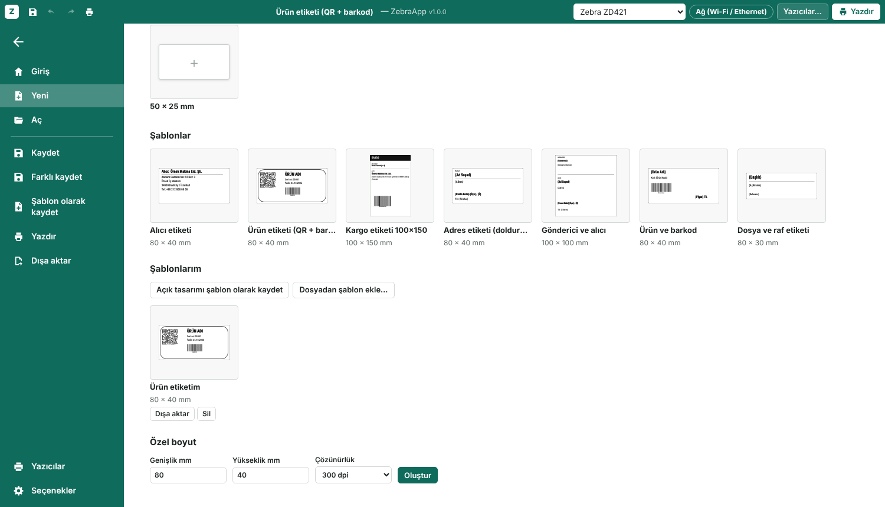
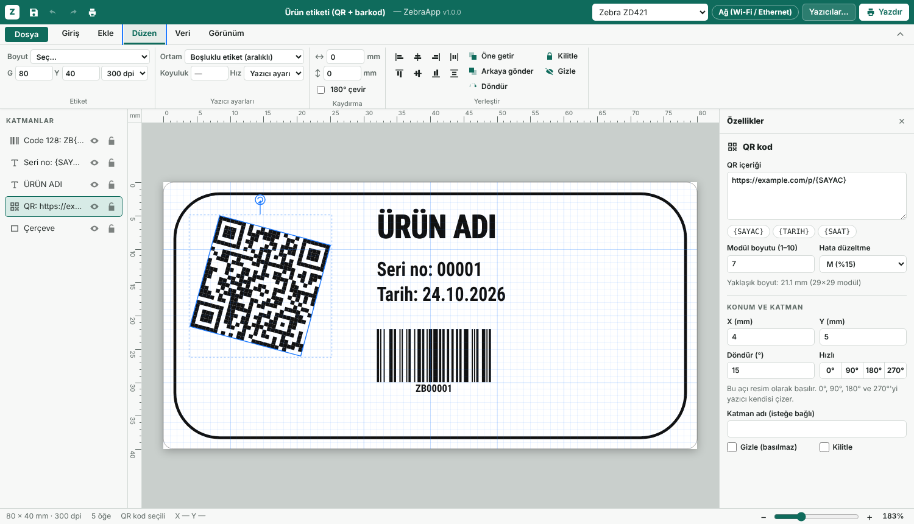

# ZebraApp

**Zebra ve diğer ZPL yazıcılar için etiket tasarım programı.** Etiketi Word gibi çalışan bir editörde (şerit menü, Dosya ekranı, doğrudan etiketin üstüne yazma) tasarlarsın, Bluetooth LE, ağ, USB ya da seri port üzerinden basarsın. Windows, macOS ve Linux'ta çalışır: uygulamayı indirip çift tıklaman yeterli.

[English](README.md)


| Başlangıç ekranı | Önizlemeli yazdırma |
|---|---|
|  |  |

| Doldurmalı şablonlar | İstediğin açıda döndürme |
|---|---|
|  |  |

ZebraDesigner yalnızca Windows'ta çalışıyor, açık kaynak etiket programlarının çoğu da ZPL'i ya da Bluetooth LE'yi desteklemiyor. ZebraApp küçük bir yerel web uygulaması: Python sunucusu yazıcıyla konuşur, editör kendi penceresinde açılır.

## Özellikler

**Tasarım**
- Word tarzı arayüz: şerit sekmeleri (Giriş, Ekle, Düzen, Veri, Görünüm), şablonlu ve son kullanılanlı Dosya ekranı, hızlı erişim çubuğu, yakınlaştırma kaydırıcısı
- Doğrudan etiketin üstüne yazıp kelime işlemci gibi biçimlendirme: kelimeleri seçip kalın, italik, altı çizili, üstü çizili, büyük ya da başka yazı tipiyle yap; punto olarak boyut, karakter aralığı, BÜYÜK/küçük/Her Kelime harf, iki yana yaslama, kutuda üst/orta/alt
- Biçim Boyacısı, Bul ve değiştir (Ctrl+H), Simge ekle
- Metin, QR kod, barkod (Code 128, Code 39, EAN-13), çizgi, kutu (köşesi yuvarlak ya da dolu), elips ve görsel/logo (eşik ve noktalama ayarıyla yazıcı bitmap'ine çevrilir)
- Fareyle seçme, taşıma ve 8 tutamaçla boyutlandırma, çoklu seçim ve alan seçimi
- Izgaraya ve diğer öğelere yapışma, kılavuz çizgileri, mm cetvelleri, yakınlaştırma
- Gizlenebilen, kilitlenebilen, yeniden adlandırılabilen ve sürükleyerek sıralanan katmanlar
- Hizalama ve eşit dağıtma, öne getirme / arkaya gönderme
- Seçimin üstündeki tutamaçla her şeyi istediğin açıyla döndürme (Shift ile 15° adım). 0°, 90°, 180° ve 270°'yi yazıcı kendisi çizer; diğer açılar resim olarak gider
- Bilgisayarında kurulu her yazı tipi (resim olarak gider, ekrandakiyle birebir aynı basılır) ya da yazıcının kendi yazı tipi
- Kutuya sığdır: CSV listesinden gelen uzun yazı her etikette ayrı ayrı küçültülür, kutusundan taşmaz
- Kalın yazı, harf genişliği, satır aralığı, ortalı ya da sağa yaslı metin kutusu, otomatik satır kaydırma, ters baskı (siyah üstüne beyaz)
- Geri al / yinele, kopyala / yapıştır, klavye kısayolları

**Baskı**
- Numaralı etiketler için `{SAYAC}`, `{TARIH}` ve `{SAAT}` değişkenleri
- CSV ile toplu baskı: herhangi bir alana `{sütun}` yazarsın, her satır için bir etiket basılır
- Etiket başına yazıcı ayarları: ortam türü (boşluklu, sürekli, siyah işaretli), koyuluk, hız, 180° çevirme, kaydırma
- Model ve çözünürlüğüyle birden çok yazıcı; etiket yazıcıya uymazsa uyarı
- [Labelary](https://labelary.com) ile yazıcı önizlemesi (internet gerekir), elle düzenlenip gönderilebilen ZPL görünümü
- Kalibrasyon, boş etiket ilerletme, ayar etiketi basma, yazıcı durumunu okuma (kâğıt bitti, kapak açık, duraklatıldı…)
- Hazır `.zpl` dosyalarını açıp düzenleme: metin, `^FB` blokları, kutu, çizgi (çapraz dahil), elips, Code 128 / Code 39 / EAN-13 / UPC-A, QR kod ve `^GFA` resimleri düzenlenebilir öğelere dönüşür; diğer komutlar atlandı diye listelenir
- Etiketler düz dosyadır (`.zebra`, içi JSON): Kaydet, Farklı kaydet ve Aç sistemin dosya penceresini kullanır, son kullanılanlar listelenir; ZPL `.zpl` dosyası olarak dışa aktarılır
- Şablon kitaplığı: hazır şablonlar (adres, gönderici ve alıcı, ürün, raf etiketi) ve kendi şablonların. Her tasarım şablon olarak kaydedilebilir; `{Ad Soyad}` gibi alanlar şablondan etiket açılırken bir formda sorulur
- PDF etiketlerini özgün ölçüsünde aç (masaüstü): sayfa ve 203/300/600 dpi seç. Tek görsel olarak aktarılır; Kaydet yeni bir `.zebra` dosyası oluşturur, PDF korunur. `pip install ".[pdf]"` gerekir (`.[all]` içinde var).
- ZebraDesigner 3 dosyaları (`.nlbl`, deneysel): aç ve ZebraDesigner için kaydet. Sabit metin, Code 128, QR, görsel, çizgi, kutu ve elips; yalnızca 300 dpi. `pip install ".[nlbl]"` gerekir
- Açılan dosyalar denetlenir (boyut, biçim, gömülü görseller); bozuk ya da yabancı bir dosya açık bir mesaj verir
- Türkçe ve İngilizce arayüz

## Desteklenen bağlantılar

| Bağlantı | Çalıştığı yer | Gereken |
|---|---|---|
| Bluetooth LE | Linux, Windows, macOS | `pip install bleak` |
| Ağ (TCP 9100 portu) | her yerde | hiçbir şey |
| Sistem yazıcısı / USB (CUPS raw kuyruğu, Windows yazıcısı) | Linux, macOS, Windows | CUPS (`lp`), Windows'ta `pip install pywin32` |
| USB aygıt dosyası (`/dev/usb/lp0`) | Linux | `lp` grubu üyeliği |
| Seri port / klasik Bluetooth (SPP) | her yerde | `pip install pyserial` |
| Harici komut (ZPL standart girişten) | her yerde | kendi komutun |

ZD (ZD421, ZD621, ZD411, ZD420, ZD410, ZD220/230, ZD888), GK/GX, ZT (ZT230, ZT411, ZT421, ZT610, ZT620) ve ZQ (ZQ320, ZQ520, ZQ620, ZQ630) aileleri için hazır profiller var. ZPL anlayan her yazıcı "Diğer ZPL yazıcı" profiliyle çalışır; başka markaların ZPL uyumlu yazıcıları da buna dahil.

ZebraApp ile hazırlanan etiketler bir ZD421'de (300 dpi) Bluetooth LE üzerinden basıldı. Diğer modeller ve bağlantı türleri Zebra'nın belgelerine göre yazıldı ama henüz gerçek donanımda denenmedi; deneyen olursa geri bildirimini bekliyorum.

## İndir

Sistemine uygun dosyayı [son sürüm](https://github.com/TroubledKezoo1/ZebraDesignApp/releases/latest) sayfasından indir:

| Sistem | Dosya |
|---|---|
| Windows 10/11 | `ZebraApp-…-windows-x64.exe` |
| Windows 10/11, ARM (Copilot+ PC'ler, Surface) | `ZebraApp-…-windows-arm64.exe` |
| macOS, Apple silicon | `ZebraApp-…-macos-arm64.dmg` |
| macOS, Intel | `ZebraApp-…-macos-x64.dmg` |
| Linux, Intel/AMD | `ZebraApp-…-x86_64.AppImage` |
| Linux, ARM64 (64 bit işletim sistemli Raspberry Pi 4/5, ARM dizüstü) | `ZebraApp-…-aarch64.AppImage` |
| Debian / Ubuntu (amd64, arm64) | `zebraapp_…_amd64.deb`, `zebraapp_…_arm64.deb` |
| Android 6+ (telefon, tablet) | `ZebraApp-…-android.apk` |

Başka bir şey kurman gerekmez. Uygulamalar imzasız olduğu için ilk açılışta sistem bir kez sorar:
- **Windows:** "Windows bilgisayarınızı korudu" → *Ek bilgi* → *Yine de çalıştır*.
- **macOS:** ZebraApp'i Uygulamalar'a sürükle, ilk açılışta sağ tık → *Aç* (ya da Sistem Ayarları → Gizlilik ve Güvenlik → *Yine de Aç*).
- **Linux:** çalıştırma izni ver (`chmod +x ZebraApp-*.AppImage`) ve çift tıkla. Açılmazsa: `sudo apt install libfuse2` (Ubuntu 24.04'te `libfuse2t64`).

Editör Chrome ya da Edge'de pencere olarak, yoksa varsayılan tarayıcıda açılır.

**Android:** `.apk` dosyasını telefonun tarayıcısında indir ve dokunarak kur (Android, o tarayıcıdan kuruluma bir kere izin ister). Uygulama Bluetooth LE ile yazdırır, etiketlerin telefonda kalır. Her açılışta GitHub'a bakar, yeni sürüm varsa **Güncelle** çubuğu çıkar (Seçenekler → *Güncellemeleri denetle* elle yapar). Ağ, USB ve seri port yazdırma ile `.nlbl` dosyaları yalnızca masaüstünde var.

## Belgeler

- [Kullanım kılavuzu](docs/KULLANIM.md): yazıcı eklemekten toplu baskıya
- [English user guide](docs/USER_GUIDE.md)

## Kaynaktan kurulum

Geliştirme için ya da hazır uygulaması olmayan sistemlerde. Python 3.8 ya da üstü gerekir.

```sh
git clone https://github.com/TroubledKezoo1/ZebraDesignApp.git
cd ZebraDesignApp
pip install ".[ble]"        # Bluetooth, seri port, Windows ve .nlbl için ".[all]"
zebraapp
```

Kurmadan da çalışır: klasörün içinde `python3 -m zebraapp`.

Editör Chrome, Chromium ya da Edge'de uygulama penceresi olarak, yoksa varsayılan tarayıcıda açılır. Pencereyi kapatınca birkaç saniye içinde kendiliğinden kapanır.

**Başlatma kısayolları**
- Linux: `scripts/install-linux.sh` uygulama menüsüne ve masaüstüne ekler.
- Windows: `scripts\ZebraApp.bat` dosyasına çift tıkla.
- macOS: `scripts/ZebraApp.command` dosyasına çift tıkla.

**git olmadan Windows'ta** (indirilen ZIP ile): ZIP'i bir klasöre çıkar, o klasörde terminal açıp şunu çalıştır

```bat
python -m venv .venv
.venv\Scripts\python.exe -m pip install ".[all]"
.venv\Scripts\python.exe -m zebraapp
```

Yazıcıları ve şablonları programın yanında tutmak için sonuna `--data-dir veriler` ekle.

Ubuntu gibi pip'in sisteme kurmaya izin vermediği yerlerde sanal ortam (`python3 -m venv .venv && . .venv/bin/activate`) ya da `pipx install ".[ble]"` kullan.

## İlk adımlar

1. Uygulama **Dosya** ekranında açılır. Boş etiket, şablon ya da son kullanılan bir dosya seç.
2. Sağ üstteki **Yazıcılar…** düğmesinden yazıcını ekle. Bluetooth yazıcıları **Ara**, sistem yazıcılarını ve seri portları **Listele** ile bul, sonra **Test etiketi bas**.
3. **Ekle** sekmesinden öğe ekle, etiket boyutunu **Düzen** sekmesinden ayarla, metne çift tıklayıp etiketin üstüne yaz.
4. **Ctrl+P** önizlemeli yazdırma ekranını açar. Etiketin çözünürlüğü yazıcıdan farklıysa uyarlamayı önerir.
5. Yeni rulo taktıktan sonra yazdırma ekranından bir kez **Kalibre et**'e bas.

Bluetooth LE yazıcı aynı anda yalnızca bir cihaza bağlanır. Bağlanmıyorsa telefonun Bluetooth'unu kapat.

## Klavye kısayolları

| Tuşlar | İşlem |
|---|---|
| `V` `T` `Q` `B` `L` `R` `E` `I` | Seç, Metin, QR, Barkod, Çizgi, Kutu, Elips, Görsel |
| `Ctrl+Z` / `Ctrl+Y` | Geri al / yinele |
| `Ctrl+C` `Ctrl+X` `Ctrl+V` `Ctrl+D` | Kopyala, kes, yapıştır, çoğalt |
| `Del` | Sil |
| Ok tuşları (`Shift` ile 10 kat) | Taşı |
| `Ctrl+S` / `Ctrl+Shift+S` ya da `F12` | Kaydet / farklı kaydet |
| `Ctrl+O` / `Ctrl+P` | Aç / yazdırma ekranı |
| Çift tık, `F2`, `Enter` | Seçili metni etiketin üstünde düzenle (`Esc` ile bitir) |
| `Ctrl+B` `Ctrl+I` `Ctrl+U`, `Ctrl+Shift+>` / `<` | Kalın, italik, altı çizili (yazarken seçili kelimelere), büyüt / küçült |
| `Ctrl+H` | Bul ve değiştir |
| `Ctrl` + tekerlek, `+` `-` `0` | Yakınlaştır, sığdır |
| `Boşluk` + sürükle | Kaydır |
| `Alt` + sürükle | Yapışmadan taşı |

## Veriler nerede

Etiketler seçtiğin yere (`.zebra` dosyası) kaydedilir. Yazıcı ayarları ve şablonların (`templates.json`) şu klasördeki JSON dosyalarında durur:
- Linux: `~/.config/zebraapp/`
- macOS: `~/Library/Application Support/ZebraApp/`
- Windows: `%APPDATA%\ZebraApp\`

Başka bir yerde (örneğin USB bellekte) tutmak için `--data-dir` ya da `ZEBRAAPP_HOME` ortam değişkenini kullan.

## Komut satırı

```
zebraapp [--port 8765] [--data-dir KLASÖR] [--no-browser]
```

`--no-browser` sunucuyu Ctrl+C'ye basana kadar açık tutar; `http://localhost:8765` adresini kendin açarsın.

## Güvenlik

Sunucu yalnızca `127.0.0.1` adresini dinler. `Host` ve `Origin` başlıklarını kontrol eder ve değişiklik yapan her istekte özel bir başlık ister; böylece girdiğin bir web sitesi yazıcına baskı gönderemez. İnternete veri gönderen tek özellik Labelary önizlemesidir, o da yalnızca düğmesine bastığında.

## Uygulamaları kendin derle

```sh
make test        # testler
make build       # bu sistem için uygulama dist/ içinde
make dist        # ayrıca AppImage (Linux) ya da dmg (macOS)
```

`make help` hepsini listeler. Windows'ta `scripts\build-windows.bat` çalıştır (`dist\ZebraApp.exe` çıkar). Python 3.9+ gerekir; her sistem kendi uygulamasını derler (.exe Linux'ta derlenemez).

## Uygulamayı kendin derle

Aynı indirmeyi herkes kendi sistemi ve işlemcisi için derleyebilir. Python 3.9 ya da üstü gerekir (Linux'ta ayrıca `curl`); gerisi yerel bir `.venv` içine kendiliğinden kurulur.

```sh
make package                         # Linux, macOS (ya da: python3 packaging/build.py package)
python packaging\build.py package    # make olmayan Windows
```

Bitmiş dosya `dist/release/` içine çıkar: Windows'ta `.exe`, macOS'ta `.dmg`, Linux'ta `.AppImage`. Diğer hedefleri `make help` listeler (`run`, `test`, `build`, `clean`). Her sistem kendi uygulamasını derlemek zorundadır; sürüm iş akışı yukarıdaki tablodaki her indirme için GitHub'da tam olarak bunu yapar.

Android uygulaması `make apk` ile derlenir (Node, JDK 17 ve Android SDK gerekir, bkz. [android/README.md](android/README.md)).

## Geliştirme

`v1.0.1` gibi bir etiket gönderildiğinde GitHub Actions Windows, macOS ve Linux uygulamalarını derleyip sürüm olarak yayınlar (`.github/workflows/release.yml`).

```sh
python -m unittest discover -s tests -v   # sunucu tarafı
node tests/js/test_zpl.js                  # ZPL üretici
```

**Yeni dil eklemek:** `zebraapp/static/js/i18n.js` içindeki `EN` sözlüğünü kopyala; anahtarlar Türkçe kaynak metinlerdir. Sunucu mesajları `zebraapp/messages.py` içinde.

**Yeni yazıcı modeli eklemek:** `zebraapp/static/js/models.js` dosyasına çözünürlükleri ve en geniş baskı alanıyla bir satır ekle.

Katkılara ve hata bildirimlerine açık, özellikle başka yazıcılarla deneme sonuçlarına.

## Lisans

MIT, bkz. [LICENSE](LICENSE). Pakete dahil edilen üçüncü taraf dosyaları (qrcode-generator, Roboto Condensed yazı tipi) [THIRD_PARTY_NOTICES.md](THIRD_PARTY_NOTICES.md) içinde.

ZebraApp bağımsız bir projedir; Zebra Technologies ile bir bağı yoktur ve onun tarafından desteklenmemektedir. Zebra, ZPL ve yazıcı model adları Zebra Technologies Corp.'un ticari markalarıdır.
