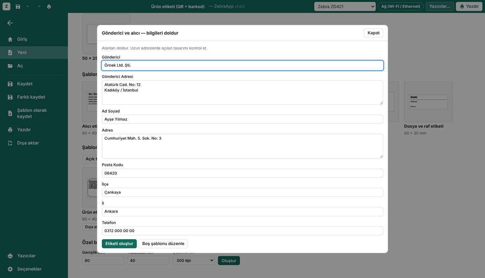

# ZebraApp kullanım kılavuzu

[English user guide](USER_GUIDE.md) · [README'ye dön](../README.tr.md)

ZebraApp bir kelime işlemci gibi çalışır: üstte şerit menü, yeni, aç, kaydet ve yazdır için **Dosya** ekranı, doğrudan etiketin üstüne yazılan metin. Bu kılavuz ilk açılıştan basılmış etikete kadar anlatır.


## 1. Uygulamayı başlat

Sistemine uygun uygulamayı [sürümler sayfasından](https://github.com/TroubledKezoo1/ZebraDesignApp/releases/latest) indirip çift tıkla (ilk açılıştaki güvenlik sorusu için README'ye bak). Kaynaktan kurduysan `zebraapp` komutunu çalıştır. Editör kendi penceresinde açılır, pencereyi kapatınca birkaç saniye sonra kendiliğinden kapanır.

Uygulama **Dosya** ekranında açılır:

- **Yeni:** boş 80 × 40 mm etiket, birkaç şablon ve kendi şablonların ya da tüm boyutlar, şablonlar ve *Şablonlarım* için **Diğer şablonlar…**
- **Son kullanılanlar:** son kaydettiğin ya da açtığın etiketler. Tıklayınca açılır.

Editöre geçmek için **Esc**'ye ya da sol üstteki geri okuna bas.


## 2. Ekranı tanı

| Bölge | Ne yapar |
|---|---|
| Başlık çubuğu | Hızlı erişim (Kaydet, Geri al, Yinele, Hızlı yazdır), etiket adı (tıklayıp değiştir), yazıcı seçimi, **Yazıcılar…** ve **Yazdır** |
| Şerit | **Dosya**, **Giriş**, **Ekle**, **Düzen**, **Veri**, **Görünüm** sekmeleri. Sağdaki ok şeridi daraltır; bir sekmeye çift tıklamak da aynısını yapar |
| Katmanlar (sol) | Göster / gizle, kilitle, yeniden adlandır (çift tık), sürükleyerek sırala |
| Etiket (orta) | Milimetre cetvelli etiket. Yakınlaştırınca ızgara yazıcının noktalarını gösterir |
| Özellikler (sağ) | Seçili öğenin bütün ayarları |
| Durum çubuğu | Etiket boyutu, öğe sayısı, seçim, imleç konumu, mesajlar ve yakınlaştırma kaydırıcısı |

**Katmanlar** ve **Özellikler** panelleri **Görünüm** sekmesinden gizlenebilir.

## 3. Yazıcını ekle

1. Başlık çubuğundaki **Yazıcılar…** düğmesine bas (ya da yazıcı listesinden **+ Yazıcı ekle…** seç) ve yeni bir yazıcı ekle.
2. **Modeli** (örneğin *ZD421*) ve **çözünürlüğü** seç (203 ya da 300 dpi; yazıcının kutusunda ve ayar etiketinde yazar).
3. **Bağlantıyı** seç:
   - **Bluetooth LE:** **Ara**'ya bas ve yazıcını seç. Yazıcı aynı anda tek cihaza bağlanır, önce telefonun Bluetooth'unu kapat.
   - **Ağ:** yazıcının IP adresi, port 9100.
   - **Sistem yazıcısı / USB:** **Listele**'ye bas ve raw kuyruğunu seç (Windows'ta kurulu Zebra sürücüsü).
   - **USB aygıt dosyası**, **Seri port**, **Harici komut:** özel kurulumlar için, README'ye bak.
4. **Test etiketi bas**'a bas. **Durumu oku** kâğıt bitti, kapak açık, duraklatıldı gibi durumları gösterir.

Birden çok yazıcı ekleyip başlık çubuğundan aralarında geçebilirsin.

## 4. Etiket boyutunu ayarla (Düzen sekmesi)

- **Boyut:** hazır bir boyut (80 × 40, 100 × 150 …) ya da milimetre olarak genişlik **G** ve yükseklik **Y**, yanında çözünürlük.
- **Ortam:** kalıplı etiketler için *Boşluklu*, aralıksız rulolar için *Sürekli*, arkasında işaret olan rulolar için *Siyah işaretli*.
- **Koyuluk** (0–30) ve **Hız:** boş bırakırsan yazıcının kendi ayarı kullanılır.
- **Kaydırma:** tasarım kenara çok yakınsa bütün tasarımı taşır. Ters çıkan etiketler için **180° çevir**.

Yeni rulo taktıktan sonra yazdırma ekranından bir kez **Kalibre et**'e bas; yazıcı etiket boyunu öğrenir.

## 5. Öğe ekle (Ekle sekmesi)

**Metin**, **QR kod**, **Barkod**, **Çizgi**, **Kutu**, **Elips** ya da **Görsel** seç, sonra etikete tıkla (çizgi, kutu ve elipste sürükle).

- Yeni metin kutusu hemen yazmaya hazır gelir.
- **Alan** grubu `{SAYAC}` (sayaç), `{TARIH}` (tarih) ya da `{SAAT}` (saat) değişkenini yazdığın yere, ya da seçili QR koda veya barkoda ekler.
- Görsel yazıcı için siyah beyaza çevrilir; **eşik**, **noktalama** ve **ters çevir** ayarları Özellikler'de.

## 6. Yaz ve biçimlendir (Giriş sekmesi)

Metne **çift tıkla** (ya da seçip **F2** veya **Enter**'a bas) ve doğrudan etiketin üstüne yaz. **Enter** yeni satıra geçer. Bitirmek için **Esc**'ye bas ya da dışarı tıkla. Boş bırakılan metin kutusu silinir.


Kelime işlemci gibi çalışır: **yazarken kelimeleri seç, biçimi sadece onlara ver**; ya da metin kutusunu (içine girmeden) seçip hepsini biçimlendir. Şeritteki düğmeler seçimin durumunu gösterir.

**Yazı grubu**

| Kontrol | Ne yapar |
|---|---|
| Yazı tipi listesi | *Yazıcı yazı tipi* (yazıcının kendisi, en hızlı), gömülü Roboto Condensed ya da bilgisayarındaki herhangi bir yazı tipi |
| Boyut (punto), **A+** / **A−** | Punto olarak yazı boyutu; Ctrl+Shift+> / < |
| **Aa** | BÜYÜK HARF, küçük harf, Her Kelimenin İlk Harfi Büyük ya da yazdığın gibi. Seçimde harflerin kendisini değiştirir; kutunun tamamında bir görünüm ayarıdır, CSV listesinden gelen yazı da çevrilir. `{ALAN}` adlarına dokunulmaz |
| Biçimi temizle | Seçimdeki ya da kutudaki bütün biçimi kaldırır |
| **K** **T** **A** **abc** | Kalın (Ctrl+B), italik (Ctrl+I), altı çizili (Ctrl+U), üstü çizili |
| Ters baskı | Siyah üstüne beyaz yazı |
| ↔ % / A↔A mm | Harf genişliği ve karakter aralığı |

**Paragraf grubu:** sola, ortaya, sağa ya da **iki yana** yaslama; uzun satırı alta kaydırma; **kutuya sığdır**; satır aralığı; kutu içinde **üst / orta / alt**; kutu genişliği ve yüksekliği.

**Pano grubu:** Yapıştır, Kes, Kopyala ve **Biçim Boyacısı**. Bir öğe seç, Biçim Boyacısı'na tıkla, sonra aynı türden başka bir öğeye tıkla; görünüşü ona kopyalanır. Birden çok öğeye uygulamak için Biçim Boyacısı'na çift tıkla; Esc bitirir.

**Düzenleme grubu:** Seç, metinlerde, QR kodlarda ve barkodlarda **Bul ve değiştir** (Ctrl+H), Tümünü seç, Metni düzenle, Çoğalt, Sil.

**Ekle → Simge** imlecin olduğu yere ° ± € ₺ © ✓ ★ gibi karakterler ekler.

**Yazıcı kendi başına neyi yapabilir?** Yazıcının kendi yazı tipi yalnızca kalın, boyut, genişlik, ters baskı ve sol/orta/sağ yaslamayı bilir. Bir metinde italik, altı çizili, üstü çizili, karakter aralığı, iki yana yaslama, bilgisayar yazı tipi ya da kelime kelime biçim kullanılınca ZebraApp onu kendisi çizer ve resim olarak gönderir. Ekrandaki gibi basılır, veri biraz büyür. Bazı simgeler de yazıcı yazı tipinde yoktur; basılmayan olursa o metne bir bilgisayar yazı tipi seç.

**Kutuya sığdır:** metne bir kutu genişliği (istersen yükseklik de) ver. Uzun yazı sığana kadar küçültülür. CSV listesiyle bu her etikette ayrı yapılır: uzun isim küçülür, kısa isim boyunu korur.

## 7. Yerleştir (Düzen sekmesi)

Öğeleri seç, sonra **Yerleştir** grubunu kullan:

- Sola, ortaya, sağa, üste, dikey ortaya, alta hizala. Tek öğe etikete göre, birden fazla öğe birbirine göre hizalanır.
- Eşit dağıt (3 ya da daha fazla öğe).
- Öne getir, arkaya gönder, 90° döndür, kilitle, gizle (gizli öğe basılmaz).
- Bir görseli 90° ya da 270° döndürünce genişliği ile yüksekliği yer değiştirir, şekli bozulmaz. *En-boy oranını koru* açıksa genişliği değiştirmek yüksekliği de değiştirir.

**İstediğin açıyla döndür:** seçili öğenin üstündeki yuvarlak tutamacı sürükle. **Shift** basılıyken 15° adımla döner; 0°, 90°, 180° ve 270°'ye kendiliğinden yapışır. Açıyı Özellikler'de *Konum ve katman* altına da yazabilirsin. 0°, 90°, 180° ve 270°'yi yazıcı kendisi çizer; diğer açılar resim olarak gider. Eğik barkodlar daha zor okunabilir.


Fareyle: sürükleyerek taşı, sekiz tutamaçla boyutlandır, **Shift** ile tıkla ya da boş alanda sürükleyerek birden çok öğe seç, sürüklerken **Alt** basılıysa yapışma kapanır. Ok tuşları az, **Shift** ile 10 kat taşır.

## 8. Numaralı etiketler ve listeler (Veri sekmesi)

**Sayaç:** herhangi bir metin, QR ya da barkoda `{SAYAC}` yaz. **Başlangıç**, **Artış** ve **Basamak**'ı ayarla (1'den başlayıp 3 basamak: 001, 002 …). Kaç tane basılacağını yazdırma ekranındaki *Farklı etiket sayısı* belirler.

**Liste (CSV):** CSV dosyası seçmek için **Liste yükle**'ye, yapıştırmak için **Listeyi düzenle…**'ye bas. İlk satır sütun adlarıdır; `;`, `,` ya da sekme ile ayrılır. Sütunlar **Alan ekle** altında çıkar; birine tıklayınca `{sütun}` seçili metne eklenir. Her satır için bir etiket basılır.

```
ad;il;telefon
Örnek Makina;İstanbul;0212 000 00 00
```

**Önizleme** altındaki oklarla her kaydı etiketin üstünde görebilirsin.

## 9. Yazdır

**Ctrl+P** (ya da Giriş sekmesindeki **Yazdır…**, ya da **Dosya → Yazdır**) yazdırma ekranını açar:

- Üstte **Yazdır** ve **Her etiketten adet**, altında yazıcı ve uyarıları, **Farklı etiket sayısı** ve toplam kaç etiket çıkacağının özeti.
- Sağda, oklarla kayıtlar arasında gezilen önizleme.
- **Yazıcı araçları:** Kalibre et, Boş etiket ilerlet, Ayar etiketi bas ve ZPL'i labelary.com'a gönderip bir Zebra'nın nasıl basacağını gösteren **Gerçek önizleme (Labelary)** (internet gerekir).

Başlık çubuğundaki yeşil **Yazdır** ve hızlı erişimdeki **Hızlı yazdır**, yazdırma ekranını açmadan doğrudan basar.


## 10. Kaydet, aç, dışa aktar (Dosya ekranı)

Etiketler `.zebra` uzantılı sıradan dosyalardır (içi JSON). Nerede duracaklarına sen karar verirsin.

| İşlem | Kısayol |
|---|---|
| **Kaydet:** ilk seferde yer ve ad sorar, sonra aynı dosyaya yazar | Ctrl+S |
| **Farklı kaydet:** her seferinde sorar | Ctrl+Shift+S, F12 |
| **Aç:** dosya seç ya da son kullanılanlardan seç | Ctrl+O |
| **Yeni** | Ctrl+N (Chrome bu kısayolu kendine ayırabilir; Dosya → Yeni'yi kullan) |

**Aç** başka programların yazdığı `.zpl` dosyalarını da açar. ZPL hangi çözünürlük için yazıldığını söylemez, bu yüzden ZebraApp sorar (ve bir öneri getirir). Metinler, metin blokları, kutular, çizgiler, elipsler, barkodlar, QR kodlar ve resimler düzenlenebilir öğelere dönüşür; tanımadığı komutlar durum çubuğunda listelenir. Sonucu Ctrl+S ile `.zebra` dosyası olarak kaydet; asıl `.zpl` dosyası değişmez.

**PDF etiketleri (masaüstü).** **Dosya → Aç → Bilgisayardan aç…** ya da **Ctrl+O** ile `.pdf` seç. Sayfa numarası ve yazıcının çözünürlüğünü seçip **Aç** de. Döndürme ve sayfa kırpma alanı dikkate alınır; örneğin 80 × 40 mm bir PDF aynı ölçüde açılır. Tasarım gömülü tek görseldir: QR, logo ve yazılar korunur, metinler ayrı ayrı düzenlenemez. Kaynak PDF değiştirilmez; **Kaydet** yeni `.zebra` dosyası ister, **ZebraDesigner için kaydet** 300 dpi'da `.nlbl` kopyası oluşturabilir. Açmak otomatik baskı başlatmaz.

`pip install ".[pdf]"` gerekir (`.[all]` içinde var). En fazla 20 MB, 500 sayfa ve seçilen sayfa için 4 milyon piksel desteklenir. Büyük sayfalarda daha düşük dpi seç; boyut otomatik olarak takılı etikete küçültülmez. Parolalı PDF'ler açılmaz. Android'de PDF açma henüz yok; masaüstünden `.zebra` dosyasına dönüştür.

**Şablonlar.** *Dosya → Yeni* hazır şablonları ve **Şablonlarım**'ı gösterir. **Şablon olarak kaydet** (Dosya menüsünde ya da Yeni sayfasındaki *Açık tasarımı şablon olarak kaydet*) açık tasarımı saklar; **Dosyadan şablon ekle…** `.zebra` dosyalarını, örneğin bir arkadaşının şablonunu, ekler. Alanları `{Ad Soyad}` ya da `{Telefon}` gibi yaz: şablondan etiket açarken bir form bunları sorar (sayaç, tarih, saat ve CSV sütunları sorulmaz). *Boş şablonu düzenle* alanları yerinde bırakarak açar. Her şablon kutucuğunda **Dışa aktar** ve **Sil** vardır.




**ZebraDesigner 3 (`.nlbl`, deneysel).** `pip install ".[nlbl]"` gerekir. **Aç** `.nlbl` dosyalarını okur; ardından **Ctrl+S** aynı dosyaya yazar, **Farklı kaydet** `.zebra` kopyası çıkarır. **Dosya → Dışa aktar → ZebraDesigner için kaydet (.nlbl)…** yeni bir dosya yazar. Yalnızca sabit metin, Code 128, QR, görsel, çizgi, kutu ve elips aktarılır, 300 dpi'da. Gizli öğeler, kelime kelime biçim, italik, altı çizili, karakter aralığı, iki yana yaslama ve kutuya sığdır düşer (ZebraApp önce uyarır). Döndürülmüş görseller resmin kendisinde döndürülür; diğer döndürmeler ve ters baskı desteklenmez.

**Dosya denetimi.** 20 MB'tan büyük, ZebraApp tasarımı olmayan, daha yeni bir sürümle yapılmış ya da görselleri gömülü değil bağlantılı olan dosyalar bir mesajla reddedilir.

**Dosya → Dışa aktar** ZPL'i `.zpl` dosyası olarak kaydeder ya da kodu gösterir; kopyalayabilir, düzenleyip elle gönderebilirsin.

**Dosya → Seçenekler**'den dil değişir. Kaydedilmemiş değişiklik varken kapatmadan ya da başka etiket açmadan önce uygulama sorar.

## 11. Sorun giderme

**Etiketin yalnızca bir kısmı basılıyor ya da kesiliyor.** Düzen sekmesindeki boyutun ve çözünürlüğün gerçek etiketlerle ve yazıcıyla aynı olduğunu kontrol et. Doğru ortam türünü seç, sonra **Kalibre et**'e bas.

**Çok açık ya da çok koyu basıyor.** Düzen sekmesinde *Koyuluk*'u birkaç adım artırarak ya da azaltarak dene.

**Bluetooth'a bağlanmıyor.** Telefonunun Bluetooth'unu kapat, yazıcıyı kullanan başka uygulamaları kapat, yeniden ara. Linux'ta `bleak` kurulu olmalı (`pip install ".[ble]"`) ve Bluetooth servisi çalışmalı.

**Baskılar arasında boş etiket çıkıyor.** Ortam türü büyük olasılıkla yanlış ya da yazıcının kalibre edilmesi gerekiyor.

**Yazdır'a basınca hiçbir şey olmuyor.** Durum çubuğundaki (ya da yazdırma ekranının üstündeki) mesaja bak. Yazıcı eklenmediyse **Yazıcılar…**'dan ekle.

**Pencere minicik ya da yanlış yerde.** Chrome uygulama pencerelerinin boyutunu adrese göre hatırlar. Bir kez büyüt ya da başka bir portta başlat: `zebraapp --port 8766`.

## 12. Her şey nerede duruyor

- Etiketlerin: kaydettiğin yer.
- Yazıcı listesi, dil ve şablonların: README'de yazan klasör (Linux'ta `~/.config/zebraapp/`).

Bilgisayarından dışarı yalnızca **Gerçek önizleme (Labelary)**'ye bastığında veri gider.
