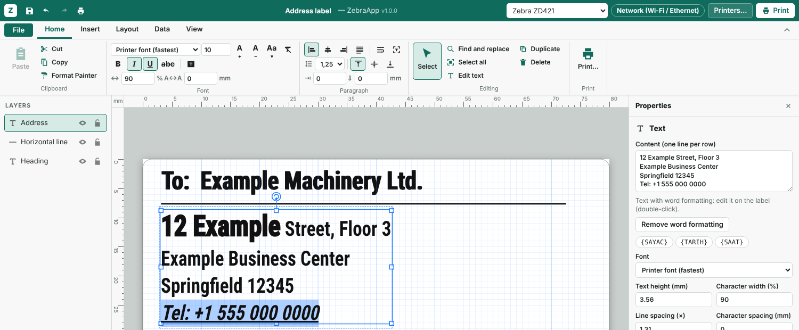
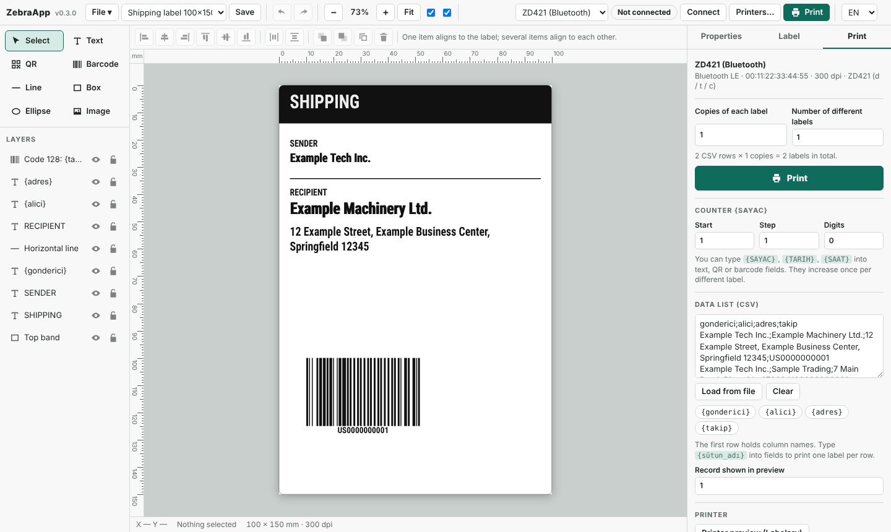
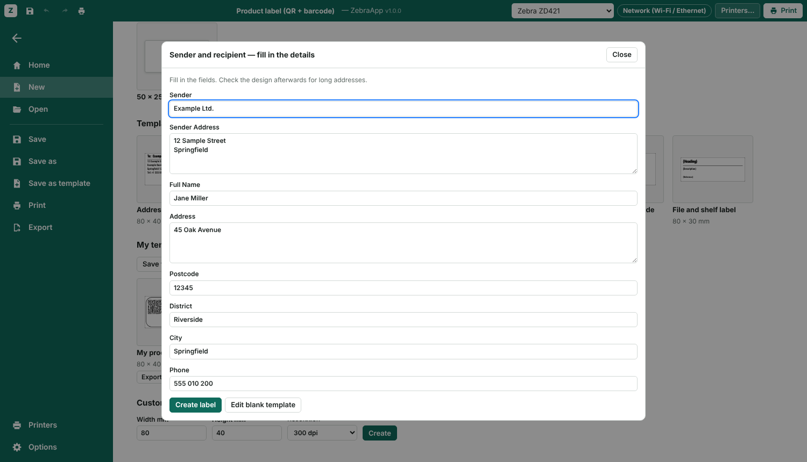

# ZebraApp user guide

[Türkçe kullanım kılavuzu](KULLANIM.md) · [Back to README](../README.md)

ZebraApp works like a word processor: a ribbon at the top, a **File** screen for new, open, save and print, and text you type straight onto the label. This guide goes from first launch to a printed label.


## 1. Start the app

Download the app for your system from the [releases page](https://github.com/TroubledKezoo1/ZebraDesignApp/releases/latest) and double-click it (see the README for the one-time security question). If you installed from source, run `zebraapp`. The editor opens in its own window and closes itself a few seconds after you close that window.

The app opens on the **File** screen:

- **New**: a blank 80 × 40 mm label, a few templates and your own templates, or **More templates…** for all sizes, templates and *My templates*.
- **Recent files**: the labels you saved or opened lately. Click one to open it.

Press **Esc** or the back arrow at the top left to go to the editor.


## 2. Find your way around

| Area | What it does |
|---|---|
| Title bar | Quick access (Save, Undo, Redo, Quick print), the label name (click to rename), printer selector, **Printers…** and **Print** |
| Ribbon | Tabs **File**, **Home**, **Insert**, **Layout**, **Data**, **View**. The arrow at the right collapses it; double-clicking a tab does the same |
| Layers (left) | Show / hide, lock, rename (double-click), drag to reorder |
| Label (middle) | The label on mm rulers. The grid shows the printer's dots when you zoom in |
| Properties (right) | Every setting of the selected item |
| Status bar | Label size, number of items, selection, pointer position, messages, and the zoom slider |

The **Layers** and **Properties** panes can be hidden on the **View** tab.

## 3. Add your printer

1. Click **Printers…** in the title bar (or choose **+ Add printer…** in the printer drop-down) and add a new printer.
2. Pick the **model** (for example *ZD421*) and the **resolution** (203 or 300 dpi; it is printed on the printer's box and on its configuration label).
3. Pick the **connection**:
   - **Bluetooth LE**: press **Scan** and choose your printer. Only one device can be connected at a time, so turn off Bluetooth on your phone first.
   - **Network**: the printer's IP address, port 9100.
   - **System printer / USB**: press **List** and choose the raw queue (Windows: the installed Zebra driver).
   - **USB device file**, **Serial port**, **External command**: for special setups, see the README.
4. Press **Print test label**. **Read status** shows paper out, open head, paused and so on.

You can add several printers and switch between them in the title bar.

## 4. Set the label size (Layout tab)

- **Size**: a preset (80 × 40, 100 × 150 …) or width **W** and height **H** in millimetres, plus the resolution.
- **Media**: *Gap* for die-cut labels, *Continuous* for rolls without gaps, *Black mark* for rolls with a mark on the back.
- **Darkness** (0 to 30) and **Speed**: leave empty to use the printer's own setting.
- **Offset**: moves the whole design if it sits too close to an edge. **Rotate 180°** for labels that come out upside down.

After loading a new roll, press **Calibrate** once on the print screen so the printer learns the label length.

## 5. Add items (Insert tab)

Choose **Text**, **QR code**, **Barcode**, **Line**, **Box**, **Ellipse** or **Image**, then click on the label (drag for lines, boxes and ellipses).

- A new text box is ready for typing right away.
- **Fields** puts `{SAYAC}` (counter), `{TARIH}` (date) or `{SAAT}` (time) where you are typing, or into the selected QR code or barcode.
- An image is converted to black and white for the printer; set **threshold**, **dither** and **invert** in Properties.

## 6. Type and format text (Home tab)

**Double-click** a text (or select it and press **F2** or **Enter**) to type directly on the label. **Enter** starts a new line. Press **Esc** or click outside to finish. A text box left empty is removed.



It works like a word processor: **select words while typing and format only them**, or select the whole text box (without typing in it) to format all of it. The ribbon buttons show the state of the selection.

**Font group**

| Control | What it does |
|---|---|
| Font list | *Printer font* (the printer's own, fastest), the built-in Roboto Condensed, or any font on your computer |
| Size (pt), **A+** / **A−** | Font size in points; Ctrl+Shift+> / < |
| **Aa** | UPPERCASE, lowercase, Capitalize Each Word, or back to as typed. On a selection it changes the letters themselves; on the whole box it is a display setting, so data from a CSV list is converted too. `{FIELD}` names are left alone |
| Clear formatting | Removes all formatting from the selection or the box |
| **B** **I** **U** **abc** | Bold (Ctrl+B), italic (Ctrl+I), underline (Ctrl+U), strikethrough |
| Reverse | White text on black |
| ↔ % / A↔A mm | Character width and character spacing |

**Paragraph group**: align left, center, right or **justify**; wrap long lines; **shrink to fit**; line spacing; **top / middle / bottom** inside the box; box width and height.

**Clipboard group**: Paste, Cut, Copy and **Format Painter**. Select an item, click Format Painter, then click another item of the same kind to copy its look. Double-click Format Painter to apply it to several items; Esc stops.

**Editing group**: Select, **Find and replace** (Ctrl+H) across texts, QR codes and barcodes, Select all, Edit text, Duplicate, Delete.

**Insert → Symbol** adds characters like ° ± € ₺ © ✓ ★ at the cursor.

**What the printer can do by itself.** The printer's own font only knows bold, size, width, reverse and left/center/right. As soon as a text uses italic, underline, strikethrough, character spacing, justify, a computer font or word-by-word formatting, ZebraApp draws it and sends it as an image. It prints exactly as on screen; the data is a little larger. Some symbols are missing from the printer font too; if one does not print, pick a computer font for that text.

**Font** and **Shrink to fit**: give the text a box width (and, if you like, a height). Text that is too long is made smaller until it fits. With a CSV list this happens label by label, so a long name gets smaller and a short one keeps its size.

## 7. Arrange (Layout tab)

Select items, then use **Arrange**:

- Align left, center, right, top, middle, bottom. One item aligns to the label; several items align to each other.
- Distribute evenly (3 or more items).
- Bring to front, send to back, rotate 90°, lock, hide (hidden items are not printed).
- Rotating an image by 90° or 270° swaps its width and height, so it keeps its shape. With *keep aspect ratio* on, changing the width also changes the height.

**Rotate to any angle**: drag the round handle above the selected item. Hold **Shift** for 15° steps; it snaps to 0°, 90°, 180° and 270° on its own. You can also type the angle under *Position and layer* in Properties. The printer draws 0°, 90°, 180° and 270° itself; any other angle is sent as an image. Barcodes at odd angles may be harder to scan.


With the mouse: drag to move, drag the eight handles to resize, **Shift**-click or drag on empty space to select several items, **Alt** while dragging to turn snapping off. Arrow keys nudge (with **Shift** 10×).

## 8. Numbered labels and lists (Data tab)

**Counter**: write `{SAYAC}` in any text, QR or barcode. Set **Start**, **Step** and **Digits** (3 digits from 1 gives 001, 002 …). The print screen's *Number of different labels* sets how many are printed.

**List (CSV)**: press **Load list** to pick a CSV file, or **Edit list…** to paste one. The first line holds the column names, separated by `;`, `,` or tabs. The columns appear under **Insert field**; click one to put `{column}` into the selected text. One label is printed per row.

```
name;city;phone
Example Machines;Istanbul;0212 000 00 00
```

Use the arrows under **Preview** to see each record on the label.



## 9. Print

**Ctrl+P** (or **Print…** on the Home tab, or **File → Print**) opens the print screen:

- **Print** and **Copies of each label** at the top, the printer and its warnings, **Number of different labels**, and a summary of how many labels will come out.
- A preview on the right, with arrows to step through records.
- **Printer tools**: Calibrate, Feed one label, Print configuration label, and **Printer preview (Labelary)**, which sends the ZPL to labelary.com and shows how a Zebra renders it (needs internet).

The green **Print** button in the title bar and **Quick print** in the quick access toolbar print right away without opening the print screen.


## 10. Save, open and export (File screen)

Labels are ordinary files with the extension `.zebra` (JSON inside). You decide where they live.

| Action | Shortcut |
|---|---|
| **Save**: first time asks for a place and a name, later saves to the same file | Ctrl+S |
| **Save as**: always asks | Ctrl+Shift+S, F12 |
| **Open**: pick a file or choose from the recent list | Ctrl+O |
| **New** | Ctrl+N (Chrome may keep this shortcut for itself; use File → New) |

**Open** also opens `.zpl` files written by other programs. ZPL does not say which resolution it was written for, so ZebraApp asks (and suggests one). Text, text blocks, boxes, lines, ellipses, barcodes, QR codes and images become items you can edit; commands it does not know are listed in the status bar. Save the result with Ctrl+S as a `.zebra` file; the original `.zpl` is not changed.

**Templates.** *File → New* lists the built-in templates and **My templates**. **Save as template** (in the File menu, or *Save the open design as a template* on the New page) keeps the current design; **Add template from file…** brings in `.zebra` files, for example from a colleague. Write fields as `{Full Name}` or `{Phone}`: when you start a label from the template, a form asks for them (counter, date, time and CSV columns are left out). *Edit blank template* opens it with the fields still in place. Each template tile has **Export** and **Delete**.




**ZebraDesigner 3 (`.nlbl`, experimental).** Needs `pip install ".[nlbl]"`. **Open** reads `.nlbl` files; **Ctrl+S** then writes back to the same file, **Save as** makes a `.zebra` copy. **File → Export → Save for ZebraDesigner (.nlbl)…** writes a new one. Only fixed text, Code 128, QR, image, line, box and ellipse carry over, at 300 dpi. Hidden items, word-by-word formatting, italic, underline, spacing, justify and shrink to fit are dropped (ZebraApp warns first). Rotated images are turned in the image itself; other rotations and reverse print are not supported.

**File checks.** A file larger than 20 MB, a file that is not a ZebraApp design, one from a newer version or one with images linked instead of embedded is refused with a message.

**File → Export** saves the ZPL as a `.zpl` file or shows the code, which you can copy, edit and send by hand.

**File → Options** sets the language. The app asks before closing or opening another label if there are unsaved changes.

## 11. Troubleshooting

**Only part of the label prints, or a label is cut off.** Check that the size and resolution on the Layout tab match the real labels and the printer. Choose the right media type, then press **Calibrate**.

**Prints too light or too dark.** Change *Darkness* on the Layout tab a few steps at a time.

**The printer will not connect over Bluetooth.** Turn off Bluetooth on your phone, close other apps using the printer, scan again. On Linux, `bleak` must be installed (`pip install ".[ble]"`) and the Bluetooth service running.

**A blank label comes out between prints.** The media type is probably wrong, or the printer needs calibrating.

**Nothing happens when I press Print.** Read the message in the status bar (or at the top of the print screen). If no printer is added, add one under **Printers…**.

**The window is tiny or in the wrong place.** Chrome remembers app window sizes per address. Maximise it once, or start on another port: `zebraapp --port 8766`.

## 12. Where things are stored

- Your labels: wherever you saved them.
- Printer list, language and your templates: the folder named in the README (`~/.config/zebraapp/` on Linux).

Nothing leaves your computer except when you press **Printer preview (Labelary)**.
